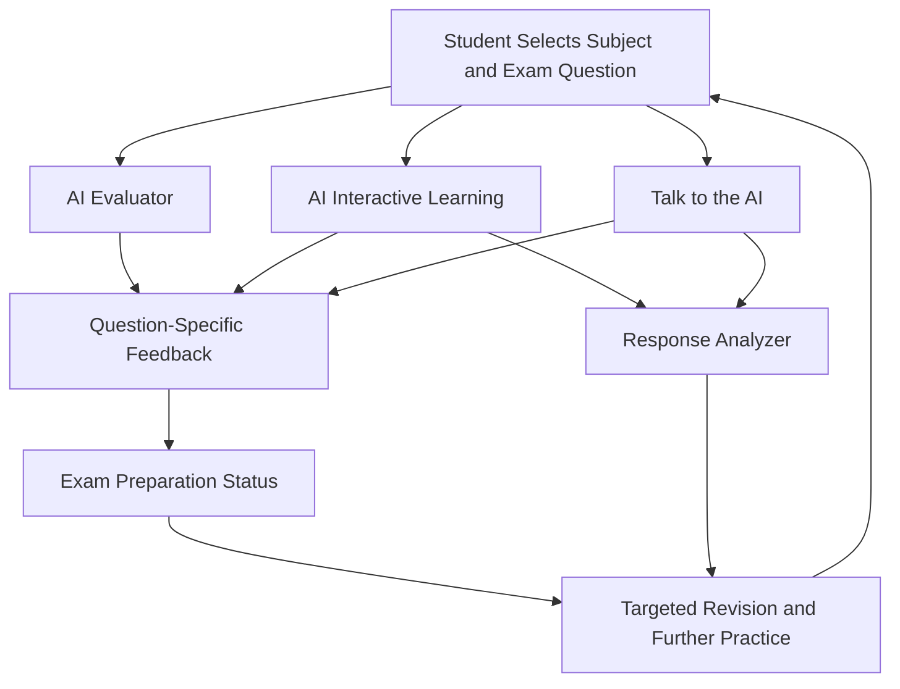
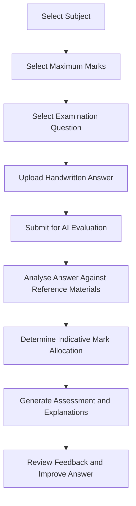
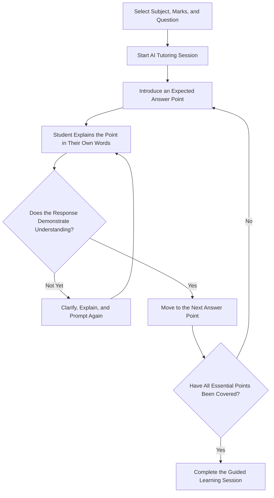

# AI Tutor — Cambridge Exam Preparation and Intelligent Learning Platform

AI Tutor is an AI-powered educational platform designed to help students prepare for Cambridge examinations using question-specific assessment, conversational tutoring, voice-based learning, and student progress analytics. The platform brings together examination reference materials, AI-driven response analysis, and structured learning workflows to support students throughout their exam preparation journey.

The system uses Cambridge examination resources in PDF format, including past papers and associated marking schemes or examiner guidance from the previous five years. These resources provide the reference material for evaluating handwritten answers, guiding students through expected answer points, and analysing their responses during interactive tutoring sessions.

Unlike a conventional chatbot that primarily generates answers to questions, AI Tutor combines assessment, guided practice, historical progress tracking, and interaction analysis in a unified learning environment. Students can submit handwritten answers for evaluation, practise individual examination questions through text or voice conversations, monitor their preparation status, and review the relevance of their responses during earlier tutoring sessions.

## Table of Contents

- [Project Overview](#project-overview)
- [Core Features](#core-features)
- [End-to-End Learning Workflow](#end-to-end-learning-workflow)
- [AI Evaluator](#ai-evaluator)
- [AI Interactive Learning](#ai-interactive-learning)
- [Exam Preparation Status](#exam-preparation-status)
- [Talk to the AI](#talk-to-the-ai)
- [Response Analyzer](#response-analyzer)
- [Integrated Learning Architecture](#integrated-learning-architecture)
- [Logical Data Model](#logical-data-model)
- [Educational Impact](#educational-impact)
- [Technical Highlights](#technical-highlights)
- [Responsible AI Considerations](#responsible-ai-considerations)

---

## Project Overview

### The Problem

Preparing for Cambridge examinations requires more than reading textbooks and memorising model answers. Students must understand examination questions, identify the relevant marking points, construct appropriate responses, and recognise how their answers meet the expected assessment criteria.

Traditional revision methods can leave students with limited opportunities to receive detailed feedback on handwritten answers, practise explaining concepts interactively, or understand why their responses do not satisfy particular marking requirements. Students may also struggle to identify which questions they have adequately prepared for and which still require revision.

Although general-purpose AI chatbots can explain academic concepts, they do not automatically provide a complete examination-preparation workflow that connects question-specific assessment, guided answer practice, progress tracking, and analysis of student interactions.

### The Solution

AI Tutor addresses these challenges by integrating five complementary capabilities into a single examination-preparation platform.

1. **AI Evaluator:** Assesses handwritten examination responses and explains the marks awarded or deducted against relevant Cambridge marking guidance.
2. **AI Interactive Learning:** Guides students through expected answer points using text-based conversations and evaluates their understanding of each point.
3. **Talk to the AI:** Provides a voice-based tutoring experience in which students speak to the AI tutor and receive spoken responses.
4. **Exam Preparation Status:** Tracks completed reflections, recorded preparedness levels, and questions that still require attention.
5. **Response Analyzer:** Analyses the contextual relevance of student responses during previous AI tutoring conversations and produces detailed evaluation reports.

These capabilities support a continuous learning process in which students can practise examination questions, receive feedback, improve their understanding, and review their preparation history.

## Core Features

- **Cambridge Resource-Grounded AI:** Uses examination reference materials from a five-year collection of Cambridge past papers, marking schemes, and examiner guidance.
- **Question-Specific Context:** Uses the selected subject, maximum marks, and examination question to establish the context for assessment and tutoring.
- **Handwritten Answer Assessment:** Enables students to submit images of handwritten answers for AI-powered evaluation.
- **Explainable Mark Allocation:** Provides explanations for awarded marks and identifies missing or insufficiently developed marking points.
- **Conversational Learning:** Guides students through expected answer points and encourages them to explain concepts in their own words.
- **Voice-Based Tutoring:** Supports spoken student interaction and audio responses from the AI tutor.
- **Historical Progress Tracking:** Organises learning records by subject and date range.
- **Preparedness Reporting:** Separates completed reflections from questions that have not yet been reflected upon.
- **Contextual Response Analysis:** Evaluates how closely student contributions address the current question, topic, and tutoring prompts.
- **AI-Generated Feedback:** Produces explanations that help students identify weaknesses and understand where further practice may be beneficial.
- **Integrated Exam Preparation:** Connects assessment, guided practice, voice interaction, progress monitoring, and response analysis within one platform.

---

## End-to-End Learning Workflow

The following conceptual workflow illustrates how the platform's capabilities complement one another throughout the examination-preparation process.

The five capabilities serve different but complementary purposes. The AI Evaluator focuses on the quality of an examination answer, while the two tutoring features help students develop their understanding. Exam Preparation Status provides a historical overview of learning progress, and Response Analyzer offers additional insight into the relevance and completeness of student contributions during tutoring sessions.

Together, these features support a feedback-driven approach to examination preparation.

---

## AI Evaluator

### AI-Powered Cambridge Examination Assessment

The AI Evaluator allows students to submit handwritten essays and examination responses for automated, question-specific assessment. It uses relevant Cambridge examination reference materials to evaluate student answers and produce explanations of the marks awarded.

### Assessment Workflow

### How It Works

Students first select the subject, maximum marks, and specific examination question they want to answer. They then upload an image of their handwritten response and submit it for evaluation.

The system analyses the submitted answer in the context of the selected question and the relevant Cambridge marking guidance. Rather than returning only a score, it provides a detailed assessment explaining which parts of the response satisfy the expected requirements and where marks may have been missed.

Students can review the reasoning behind individual marking decisions, identify missing answer points, and understand why certain explanations may not be sufficient to earn the expected marks.

### Key Capabilities

- Handwritten response submission through image uploads.
- Subject-, question-, and mark-specific assessment.
- Reference-based evaluation using relevant Cambridge examination resources.
- Explanations of marks awarded and marks deducted or not earned.
- Identification of missing or insufficiently developed answer points.
- Actionable feedback for subsequent examination practice.

### Educational Value

The AI Evaluator helps students understand not only how they performed, but also why their responses received an indicative score. This supports independent revision, repeated past-paper practice, and a clearer understanding of examination expectations.

---

## AI Interactive Learning

### Conversational Tutoring and Point-by-Point Answer Mastery

AI Interactive Learning turns examination preparation into a structured conversation. Instead of simply displaying a model answer for memorisation, the AI tutor guides students through the expected answer one point at a time.

### Learning Workflow

### How It Works

The student selects the subject, maximum marks, and examination question. The AI tutor then introduces an important point from the expected answer and asks the student to explain it in their own words.

The tutor evaluates whether the student's paraphrase captures the essential meaning of that point. If the explanation demonstrates sufficient understanding, the conversation progresses to the next point. If the response is incomplete, unclear, or inaccurate, the tutor provides additional explanation and guidance before continuing.

The process repeats until the essential points of the selected answer have been covered.

### Key Capabilities

- Question-specific
