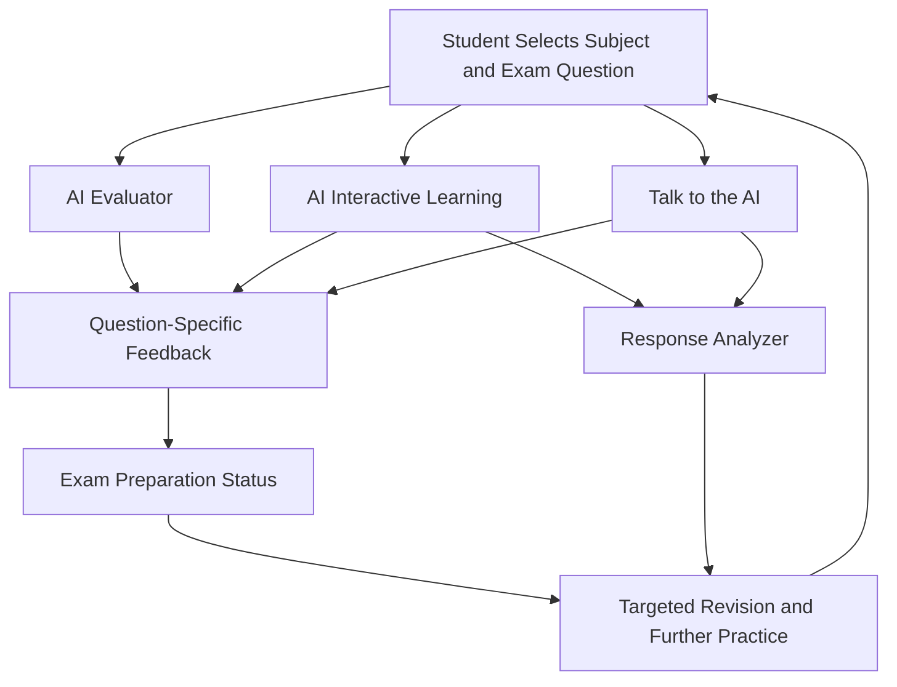
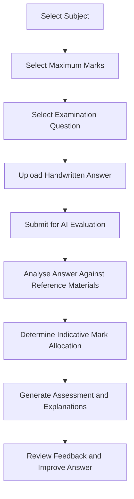
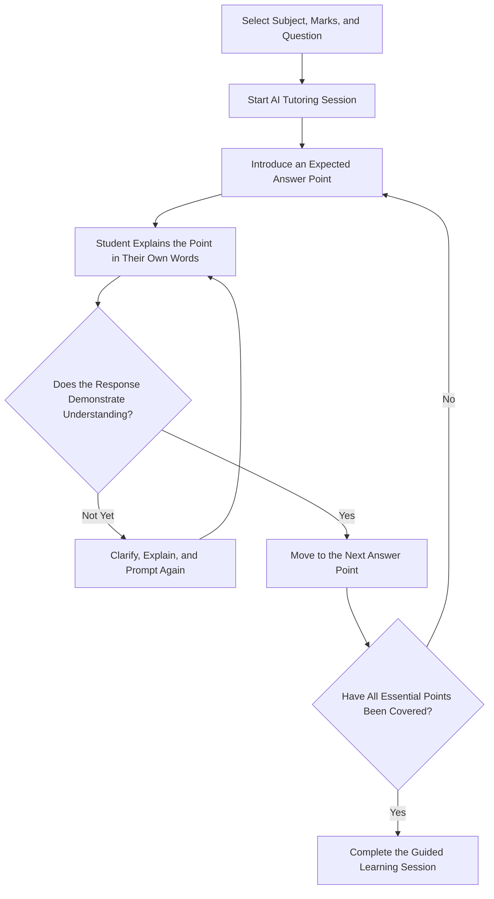
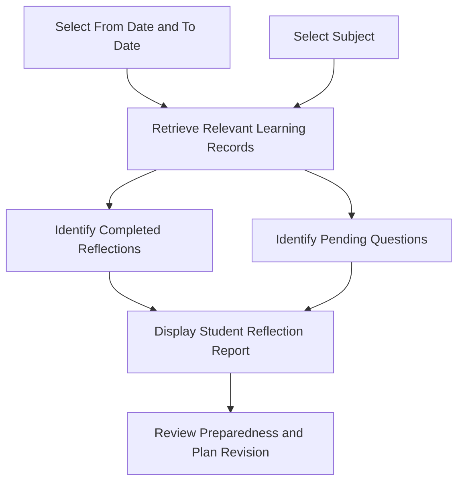
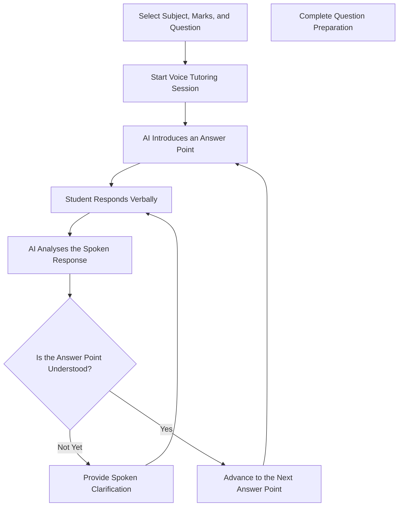
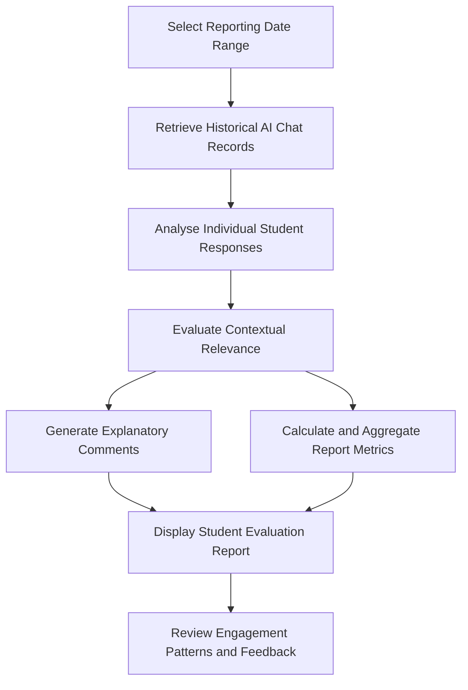
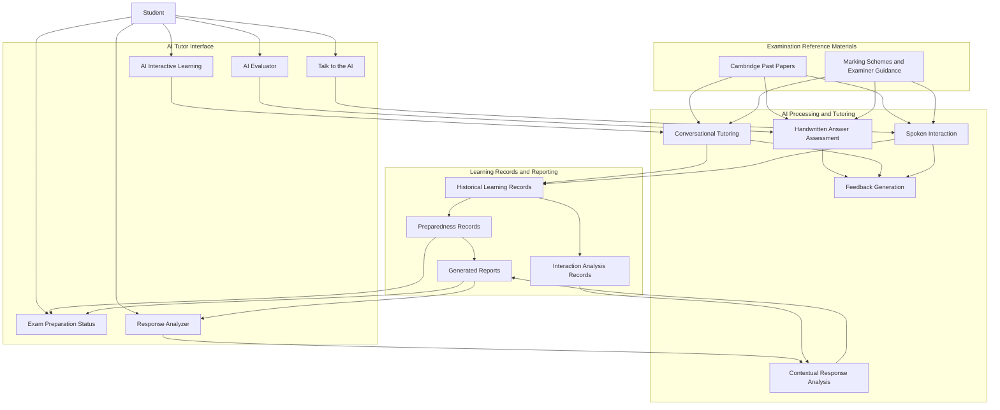

# AI Tutor — Cambridge Exam Preparation and Intelligent Learning Platform

AI Tutor is an AI-powered educational platform designed to help students prepare for Cambridge examinations using question-specific assessment, conversational tutoring, voice-based learning, and student progress analytics. The platform brings together examination reference materials, AI-driven response analysis, and structured learning workflows to support students throughout their exam preparation journey.

The system uses Cambridge examination resources in PDF format, including past papers and associated marking schemes or examiner guidance from the previous five years. These resources provide the reference material for evaluating handwritten answers, guiding students through expected answer points, and analysing their responses during interactive tutoring sessions.

Unlike a conventional chatbot that primarily generates answers to questions, AI Tutor combines assessment, guided practice, historical progress tracking, and interaction analysis in a unified learning environment. Students can submit handwritten answers for evaluation, practise individual examination questions through text or voice conversations, monitor their preparation status, and review the relevance of their responses during earlier tutoring sessions.

## Table of Contents

- [Project Overview](#project-overview)
- [Core Features](#core-features)
- [End-to-End Learning Workflow](#end-to-end-learning-workflow)
- [AI Evaluator](#ai-evaluator)
- [AI Interactive Learning](#ai-interactive-learning)
- [Exam Preparation Status](#exam-preparation-status)
- [Talk to the AI](#talk-to-the-ai)
- [Response Analyzer](#response-analyzer)
- [Integrated Learning Architecture](#integrated-learning-architecture)
- [Logical Data Model](#logical-data-model)
- [Educational Impact](#educational-impact)
- [Technical Highlights](#technical-highlights)
- [Responsible AI Considerations](#responsible-ai-considerations)

---

## Project Overview

### The Problem

Preparing for Cambridge examinations requires more than reading textbooks and memorising model answers. Students must understand examination questions, identify the relevant marking points, construct appropriate responses, and recognise how their answers meet the expected assessment criteria.

Traditional revision methods can leave students with limited opportunities to receive detailed feedback on handwritten answers, practise explaining concepts interactively, or understand why their responses do not satisfy particular marking requirements. Students may also struggle to identify which questions they have adequately prepared for and which still require revision.

Although general-purpose AI chatbots can explain academic concepts, they do not automatically provide a complete examination-preparation workflow that connects question-specific assessment, guided answer practice, progress tracking, and analysis of student interactions.

### The Solution

AI Tutor addresses these challenges by integrating five complementary capabilities into a single examination-preparation platform.

1. **AI Evaluator:** Assesses handwritten examination responses and explains the marks awarded or deducted against relevant Cambridge marking guidance.
2. **AI Interactive Learning:** Guides students through expected answer points using text-based conversations and evaluates their understanding of each point.
3. **Talk to the AI:** Provides a voice-based tutoring experience in which students speak to the AI tutor and receive spoken responses.
4. **Exam Preparation Status:** Tracks completed reflections, recorded preparedness levels, and questions that still require attention.
5. **Response Analyzer:** Analyses the contextual relevance of student responses during previous AI tutoring conversations and produces detailed evaluation reports.

These capabilities support a continuous learning process in which students can practise examination questions, receive feedback, improve their understanding, and review their preparation history.

## Core Features

- **Cambridge Resource-Grounded AI:** Uses examination reference materials from a five-year collection of Cambridge past papers, marking schemes, and examiner guidance.
- **Question-Specific Context:** Uses the selected subject, maximum marks, and examination question to establish the context for assessment and tutoring.
- **Handwritten Answer Assessment:** Enables students to submit images of handwritten answers for AI-powered evaluation.
- **Explainable Mark Allocation:** Provides explanations for awarded marks and identifies missing or insufficiently developed marking points.
- **Conversational Learning:** Guides students through expected answer points and encourages them to explain concepts in their own words.
- **Voice-Based Tutoring:** Supports spoken student interaction and audio responses from the AI tutor.
- **Historical Progress Tracking:** Organises learning records by subject and date range.
- **Preparedness Reporting:** Separates completed reflections from questions that have not yet been reflected upon.
- **Contextual Response Analysis:** Evaluates how closely student contributions address the current question, topic, and tutoring prompts.
- **AI-Generated Feedback:** Produces explanations that help students identify weaknesses and understand where further practice may be beneficial.
- **Integrated Exam Preparation:** Connects assessment, guided practice, voice interaction, progress monitoring, and response analysis within one platform.

---

## End-to-End Learning Workflow

The following conceptual workflow illustrates how the platform's capabilities complement one another throughout the examination-preparation process.

The five capabilities serve different but complementary purposes. The AI Evaluator focuses on the quality of an examination answer, while the two tutoring features help students develop their understanding. Exam Preparation Status provides a historical overview of learning progress, and Response Analyzer offers additional insight into the relevance and completeness of student contributions during tutoring sessions.

Together, these features support a feedback-driven approach to examination preparation.

---

## AI Evaluator

### AI-Powered Cambridge Examination Assessment

The AI Evaluator allows students to submit handwritten essays and examination responses for automated, question-specific assessment. It uses relevant Cambridge examination reference materials to evaluate student answers and produce explanations of the marks awarded.

### Assessment Workflow

### How It Works

Students first select the subject, maximum marks, and specific examination question they want to answer. They then upload an image of their handwritten response and submit it for evaluation.

The system analyses the submitted answer in the context of the selected question and the relevant Cambridge marking guidance. Rather than returning only a score, it provides a detailed assessment explaining which parts of the response satisfy the expected requirements and where marks may have been missed.

Students can review the reasoning behind individual marking decisions, identify missing answer points, and understand why certain explanations may not be sufficient to earn the expected marks.

### Key Capabilities

- Handwritten response submission through image uploads.
- Subject-, question-, and mark-specific assessment.
- Reference-based evaluation using relevant Cambridge examination resources.
- Explanations of marks awarded and marks deducted or not earned.
- Identification of missing or insufficiently developed answer points.
- Actionable feedback for subsequent examination practice.

### Educational Value

The AI Evaluator helps students understand not only how they performed, but also why their responses received an indicative score. This supports independent revision, repeated past-paper practice, and a clearer understanding of examination expectations.

---

## AI Interactive Learning

### Conversational Tutoring and Point-by-Point Answer Mastery

AI Interactive Learning turns examination preparation into a structured conversation. Instead of simply displaying a model answer for memorisation, the AI tutor guides students through the expected answer one point at a time.

### Learning Workflow

### How It Works

The student selects the subject, maximum marks, and examination question. The AI tutor then introduces an important point from the expected answer and asks the student to explain it in their own words.

The tutor evaluates whether the student's paraphrase captures the essential meaning of that point. If the explanation demonstrates sufficient understanding, the conversation progresses to the next point. If the response is incomplete, unclear, or inaccurate, the tutor provides additional explanation and guidance before continuing.

The process repeats until the essential points of the selected answer have been covered.

### Key Capabilities

- Question-specific conversational tutoring.
- Structured, point-by-point answer preparation.
- Evaluation of student paraphrases for conceptual understanding.
- Clarification and additional guidance when responses are insufficient.
- Progressive learning through a sequence of answer points.
- Preparation grounded in relevant Cambridge past-paper resources.

### Educational Value

This feature encourages active recall and conceptual understanding rather than verbatim memorisation. Students practise expressing ideas independently and receive guidance when their explanations do not adequately capture the expected meaning.

---

## Exam Preparation Status

### Student Progress Tracking and Preparedness Reporting

Exam Preparation Status provides a historical overview of a student's preparation for individual examination questions. It uses records from earlier AI Interactive Learning sessions to organise completed reflections and questions that still require attention.

### Reporting Workflow

### How It Works

Students select a start date, end date, and subject to generate a Student Reflection Report.

The report separates records into two categories:

- **Completed Reflections:** Questions for which the student has completed the relevant learning and reflection process. Each record can include the activity date, question, subject, and recorded preparedness level.
- **Pending Questions:** Questions that have not yet been reflected upon, helping students identify outstanding preparation activities.

Preparedness indicators, such as `well_prepared`, provide a record of the student's demonstrated understanding during the earlier AI-guided learning process.

### Key Capabilities

- Date-range filtering of preparation records.
- Subject-specific progress reporting.
- Historical records of question-level learning activities.
- Completed reflection tracking.
- Identification of pending questions.
- Recorded preparedness indicators for individual questions.

### Educational Value

The feature helps students turn their previous tutoring activities into a more organised revision plan. By distinguishing completed learning activities from outstanding questions, it makes it easier to identify what has been covered and where additional practice may be needed.

---

## Talk to the AI

### Voice-Enabled Conversational Exam Preparation

Talk to the AI extends the platform's text-based tutoring approach into spoken interaction. Students can communicate verbally with the AI tutor and receive spoken responses while preparing for a selected Cambridge examination question.

### Voice Tutoring Workflow

### How It Works

Students select the subject, maximum marks, and question before starting a voice-based tutoring session.

The AI tutor guides the student through the expected answer points. The student explains each point verbally, and the AI analyses the response in context. When the student demonstrates sufficient understanding, the tutor proceeds to the next point. Otherwise, it provides further guidance through spoken feedback.

The interaction continues until the student has worked through the essential points of the selected answer.

### Key Capabilities

- Spoken interaction between student and AI tutor.
- AI-generated audio responses.
- Question-specific conversational guidance.
- Analysis of student responses in the context of the current answer point.
- Spoken explanations and clarification.
- Structured, point-by-point examination preparation.

### Educational Value

Voice-based tutoring gives students an alternative to typing their responses. It encourages them to practise explaining concepts aloud, listen to feedback, and engage in a conversational learning experience that complements text-based study.

---

## Response Analyzer

### AI-Powered Contextual Relevance and Engagement Analysis

Response Analyzer evaluates the contextual relevance of student contributions during previous AI tutoring conversations. It generates a Student Evaluation Report containing an overall summary and detailed assessments of individual responses.

The feature focuses on how closely student contributions address the learning objective, the examination question, and the AI tutor's prompts.

### Analysis Workflow

### How It Works

Users select a start date and end date to review historical tutoring interactions. The report presents an overview of recorded interaction time and contextual relevance, followed by individual response assessments.

Each detailed record includes a relevance percentage, an explanatory comment, and a timestamp. The comments explain how well the student's response addresses the current learning objective and whether it adequately develops the relevant concept or follows the tutor's prompts.

For example, a student might identify a relevant concept but fail to explain its significance fully. The report can highlight this gap, distinguishing partial engagement with a question from a more complete and relevant explanation.

### Key Capabilities

- Historical analysis of AI tutoring conversations.
- Date-range filtering of interaction records.
- Contextual relevance scores for individual responses.
- Summary metrics for recorded interaction time and relevance.
- AI-generated explanatory comments.
- Timestamped response-level evaluation records.
- Identification of incomplete or insufficiently developed responses.

### Educational Value

Response Analyzer provides additional insight into the quality of student participation during AI-assisted learning. Its feedback can help students recognise when their explanations are incomplete, insufficiently relevant, or in need of further development.

The feature complements Exam Preparation Status: the latter tracks completed and pending preparation activities, while Response Analyzer examines the contextual relevance of contributions made during tutoring interactions.

Importantly, contextual relevance is not a definitive measure of a student's seriousness, attention, or effort. It is an indicator of how well recorded responses relate to the learning context.

---

## Integrated Learning Architecture

AI Tutor brings together five user-facing capabilities supported by examination reference materials and historical learning records.

The following diagram illustrates the platform's conceptual architecture. It describes the logical relationships between the main components rather than prescribing a particular programming language, framework, or infrastructure.

### Architectural Responsibilities

**Student-facing interface**

- Provides separate interfaces for assessment, interactive learning, voice tutoring, preparation reporting, and response analysis.
- Collects question-selection inputs and student responses.
- Presents AI-generated feedback and historical reports.

**AI assessment and tutoring**

- Evaluates handwritten responses against the selected examination question.
- Guides students through expected answer points.
- Analyses paraphrases and spoken responses in context.
- Generates explanations and learning feedback.

**Examination reference materials**

- Supply relevant past-paper questions and assessment guidance.
- Provide the reference context for question-specific assessment and tutoring.

**Learning records and reporting**

- Support the retrieval of historical learning activities.
- Provide records for completed reflections and preparedness indicators.
- Support contextual response analysis and date-filtered reports.

*The architecture above is a conceptual representation based on the documented feature behaviour. Exact service boundaries, database schemas, API endpoints, and infrastructure depend on the implemented application.*

---

## Logical Data Model

The platform's documented workflows imply several categories of information that support assessment, tutoring, and reporting. These are logical data categories, not claims about the names or structure of actual database tables.

| Data category | Purpose |
|---|---|
| Examination reference materials | Provide past-paper questions, marking schemes, and examiner guidance. |
| Question selection | Establishes the subject, maximum marks, and question for an assessment or tutoring session. |
| Student submissions | Contains uploaded handwritten responses for evaluation. |
| Tutoring interactions | Represents student responses and AI tutor exchanges during text- or voice-based sessions. |
| Preparedness records | Supports completed reflections and question-level preparedness indicators. |
| Response analysis records | Supports response-level relevance scores, explanatory comments, and timestamps. |
| Reporting parameters | Defines the date range and subject used to retrieve relevant historical records. |
| Generated reports | Presents assessment feedback, preparation status, and interaction analysis. |

These information categories allow the platform's five capabilities to serve different purposes while working within the same broader examination-preparation experience.

---

## Educational Impact

AI Tutor is designed around a central principle: examination preparation should involve more than receiving an answer or a score. Students also need opportunities to understand assessment criteria, practise explaining concepts, receive feedback, and recognise where additional preparation is necessary.

The platform supports this process through five complementary capabilities:

- **Assess:** Evaluate handwritten answers and explain indicative mark allocation.
- **Teach:** Guide students through examination answers one point at a time.
- **Interact:** Provide spoken tutoring as an alternative to text-based learning.
- **Track:** Record preparation activities and identify questions requiring further attention.
- **Analyse:** Examine the contextual relevance and completeness of student responses during tutoring.

By combining these capabilities, AI Tutor supports a more structured and feedback-driven approach to Cambridge examination preparation.

---

## Technical Highlights

The project demonstrates the application of several AI and software engineering concepts in an educational setting:

- **Large Language Models (LLMs):** Power conversational tutoring, answer analysis, and feedback generation.
- **Document-Based Knowledge Grounding:** Uses Cambridge examination PDFs and relevant marking guidance as reference material for question-specific tasks.
- **Handwritten Response Processing:** Supports assessment of student-submitted answer images.
- **Context-Aware AI Evaluation:** Analyses responses in relation to a selected examination question and its requirements.
- **Conversational Learning Workflows:** Structures tutoring around sequential answer points and student paraphrases.
- **Voice-Based AI Interaction:** Extends conversational tutoring to spoken student input and audio responses.
- **Historical Activity Tracking:** Uses earlier tutoring records to support preparation and interaction reports.
- **Date- and Subject-Based Reporting:** Organises historical learning information for targeted review.
- **AI-Generated Explanations:** Makes assessment decisions and response-analysis results more understandable to students.
- **Integrated Educational Workflows:** Combines assessment, tutoring, progress monitoring, and response analysis in one platform.

---

## Responsible AI Considerations

AI-generated assessments and tutoring feedback are intended to support examination preparation rather than replace official examiner decisions or teacher guidance.

Marks generated by the AI should be treated as indicative rather than guaranteed equivalents of official marking. Contextual relevance scores should likewise be interpreted as measures of response relevance, not definitive assessments of a student's effort, attention, or academic ability.

The platform's greatest educational value lies in providing students with additional opportunities to practise, receive explanations, identify weaknesses, and improve their understanding of examination requirements.

